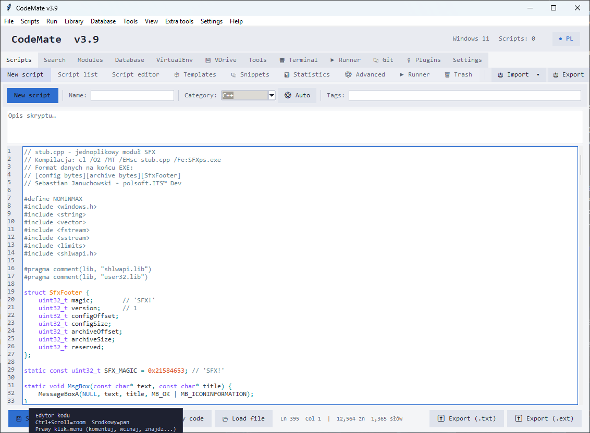

# CodeMate v4.0



**CodeMate** to aplikacja do zarządzania skryptami w językach Python, Bash, PowerShell, JavaScript i SQL — z edytorem, harmonogramem zadań, integracją z Gitem, REST API oraz systemem wtyczek.

> [!TIP]
> **Licencja:** Freeware. Darmowy do użytku prywatnego i komercyjnego. Redystrybucja dozwolona wyłącznie w niezmienionej, oryginalnej formie.

## Funkcje

- **Edytor z podświetlaniem składni** — Python, Bash, PowerShell, JavaScript, SQL
- **Harmonogram zadań** — automatyczne uruchamianie skryptów według harmonogramu
- **Kosz** — bezpieczne usuwanie i przywracanie skryptów
- **Szablony** — szybkie tworzenie nowych skryptów na podstawie szablonów
- **Statystyki** — szczegółowe statystyki użycia skryptów
- **Wyszukiwanie** — szybkie wyszukiwanie w całej bazie
- **Eksport/Import** — łatwy transfer bazy między komputerami
- **VirtualEnv** — zarządzanie wirtualnymi środowiskami Pythona
- **VDrive** — dysk wirtualny do przechowywania plików
- **Terminal** — wbudowany terminal
- **Runner** — uruchamianie skryptów z pełnym monitoringiem
- **Integracja z Gitem** — automatyczna wersjonowanie zmian i bezpieczna synchronizacja (fast-forward)
- **System wtyczek i marketplace** — instalacja z katalogu HTTPS z weryfikacją SHA-256
- **Eksport `.exe`** — budowanie samodzielnych aplikacji Pythona przez PyInstaller
- **REST API** — uruchamianie zaufanych skryptów, sprawdzanie statusów zadań i ich anulowanie

> [!NOTE]
> Pełna dokumentacja znajduje się w plikach Sphinx (`en/` i `pl/`). Aby ją zbudować, uruchom `make html` w katalogu `docs/`.

## Wymagania

- Python 3.8 lub nowszy
- Tkinter (zwykle dołączony do Pythona)
- Git (opcjonalnie — umożliwia wersjonowanie i synchronizację)

## Szybki start

1. Sklonuj repozytorium:

   ```bash
   git clone https://github.com/polsoft-IT/CodeMate.git
   cd CodeMate
   ```

2. Zainstaluj zależności:

   ```bash
   pip install -r requirements.txt
   ```

3. Uruchom aplikację:

   ```bash
   python baza_skryptow.py
   ```

> [!IMPORTANT]
> Przy pierwszym uruchomieniu aplikacja automatycznie tworzy pliki `baza_skryptow.json` i `baza_skryptow.cfg`, inicjuje repozytorium Git (jeśli Git jest dostępny) oraz ładuje wtyczki z katalogu `plugins/`.

## Opcjonalne zależności

> [!WARNING]
> Bez pakietu **Pygments** podświetlanie składni w edytorze jest wyłączone.

```bash
pip install pygments
```

## Najważniejsze ustawienia konfiguracji

| Ustawienie         | Opis                                              | Domyślnie |
|--------------------|---------------------------------------------------|-----------|
| `db_path`          | Ścieżka do bazy skryptów                          | auto      |
| `autosave`         | Automatyczny zapis bazy                           | `1`       |
| `backup_count`     | Liczba przechowywanych kopii zapasowych bazy      | `3`       |
| `git_enabled`      | Wersjonowanie skryptów w Gicie                    | `1`       |
| `git_auto_commit`  | Automatyczny commit po zmianach                   | `1`       |
| `plugins_enabled`  | Ładowanie wtyczek przy starcie                    | `1`       |
| `language`         | Język interfejsu                                  | `en`      |

## Dokumentacja

| Sekcja         | Angielski                            | Polski                             |
|----------------|--------------------------------------|------------------------------------|
| Instalacja     | [en/installation.rst](en/installation.rst) | [pl/installation.rst](pl/installation.rst) |
| Użytkowanie    | [en/usage.rst](en/usage.rst)         | [pl/usage.rst](pl/usage.rst)       |
| Wtyczki        | [en/plugins.rst](en/plugins.rst)     | [pl/plugins.rst](pl/plugins.rst)   |
| Contributing   | [en/contributing.rst](en/contributing.rst) | [pl/contributing.rst](pl/contributing.rst) |
| API            | [api.rst](api.rst)                   | —                                  |

## Licencja

Freeware — zobacz informację na początku tego pliku.

## Autor

- **Autor:** Sebastian Januchowski
- **Firma:** polsoft.ITS™ Group
- **E-mail:** [polsoft.its@mail.com](mailto:polsoft.its@mail.com)
- **GitHub:** [https://github.com/polsoft-IT](https://github.com/polsoft-IT)
