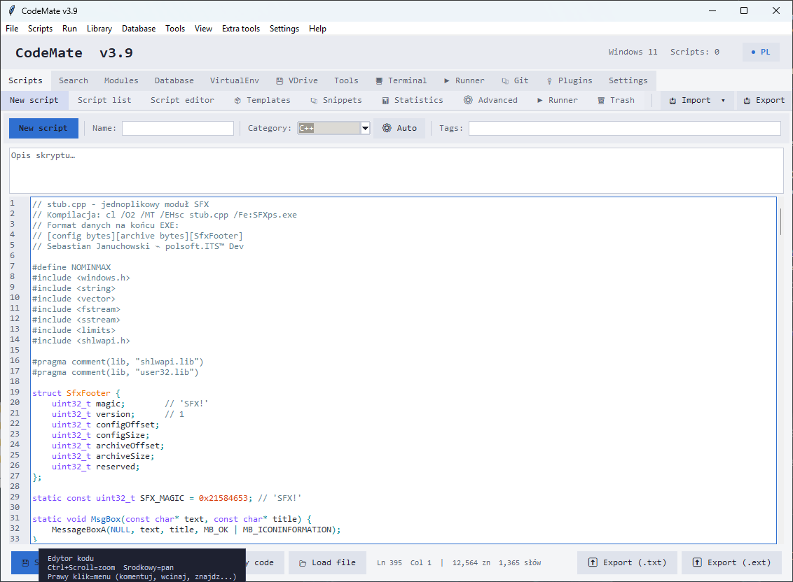

# CodeMate v4.0



**CodeMate** is an application for managing Python, Bash, PowerShell, JavaScript and SQL scripts — with an editor, scheduler, Git integration, REST API, and a plugin system.

> [!TIP]
> **License:** Freeware. Free for personal and commercial use. Redistribution is permitted only in unmodified, original form.

## Features

- **Editor with syntax highlighting** — Python, Bash, PowerShell, JavaScript, SQL
- **Task scheduler** — automatic script execution on a schedule
- **Trash** — safe deletion and restoration of scripts
- **Templates** — quick creation of new scripts from templates
- **Statistics** — detailed script usage statistics
- **Search** — fast search across the entire database
- **Export/Import** — easy database transfer between computers
- **VirtualEnv** — Python virtual environment management
- **VDrive** — virtual drive for file storage
- **Terminal** — built-in terminal
- **Runner** — run scripts with full monitoring
- **Git integration** — automatic versioning of changes and safe fast-forward sync
- **Plugin system & marketplace** — install from an HTTPS catalog with SHA-256 verification
- **`.exe` export** — build standalone Python applications via PyInstaller
- **REST API** — run trusted scripts, check job statuses, cancel jobs

> [!NOTE]
> Full documentation is available in the Sphinx docs (`en/` and `pl/` subfolders). Run `make html` in the `docs/` directory to build it.

## Requirements

- Python 3.8 or newer
- Tkinter (usually bundled with Python)
- Git (optional — enables versioning and sync)

## Quick start

1. Clone the repository:

   ```bash
   git clone https://github.com/<your-user>/CodeMate.git
   cd CodeMate
   ```

2. Install the dependencies:

   ```bash
   pip install -r requirements.txt
   ```

3. Start the application:

   ```bash
   python baza_skryptow.py
   ```

> [!IMPORTANT]
> On first launch the application automatically creates `baza_skryptow.json` and `baza_skryptow.cfg`, initializes a Git repository (if Git is available), and loads plugins from the `plugins/` directory.

## Optional dependencies

> [!WARNING]
> Without **Pygments**, syntax highlighting in the editor is disabled.

```bash
pip install pygments
```

## Configuration highlights

| Setting            | Description                                       | Default |
|--------------------|---------------------------------------------------|---------|
| `db_path`          | Path to the script database                       | auto    |
| `autosave`         | Automatic save of the database                    | `1`     |
| `backup_count`     | Number of database backups kept                   | `3`     |
| `git_enabled`      | Git versioning of scripts                         | `1`     |
| `git_auto_commit`  | Commit automatically after changes                | `1`     |
| `plugins_enabled`  | Load plugins on startup                           | `1`     |
| `language`         | Interface language                                | `en`    |

## Documentation

| Section        | English                              | Polish                             |
|----------------|--------------------------------------|------------------------------------|
| Installation   | [en/installation.rst](en/installation.rst) | [pl/installation.rst](pl/installation.rst) |
| Usage          | [en/usage.rst](en/usage.rst)         | [pl/usage.rst](pl/usage.rst)       |
| Plugins        | [en/plugins.rst](en/plugins.rst)     | [pl/plugins.rst](pl/plugins.rst)   |
| Contributing   | [en/contributing.rst](en/contributing.rst) | [pl/contributing.rst](pl/contributing.rst) |
| API            | [api.rst](api.rst)                   | —                                  |

## License

Freeware — see the notice at the top of this file.

## Test results


## Author

- **Author:** Sebastian Januchowski
- **Company:** polsoft.ITS™ Group
- **Email:** [polsoft.its@mail.com](mailto:polsoft.its@mail.com)
- **GitHub:** [https://github.com/polsoft-IT](https://github.com/polsoft-IT)
